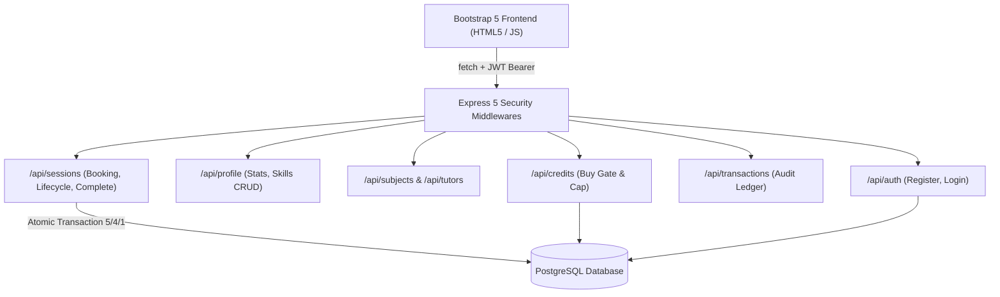

# ⚡ SkillSwap: University Peer-to-Peer Tutoring & Time Banking

**SkillSwap** is a university peer-to-peer academic tutoring platform powered by a localized time-banking economy called **SkillCredits**. Students earn credits by tutoring classmates in their strongest subjects, and spend them when they need academic assistance in other courses.

---

## 🌟 The Core SkillCredit Economy

| Actor | Action / Role | Credit Movement |
|---|---|:---:|
| **New User** | Registration Signup Bonus | **+5 Credits** (from System Wallet `id=0`) |
| **Student** | Completes 1-hour Tutoring Session | **-5 Credits** (`session_charge`) |
| **Tutor** | Conducts Tutoring Session | **+4 Credits** (`session_earning`) |
| **Platform** | System Sink (Inflation prevention) | **+1 Credit** (`platform_fee` to `id=0`) |
| **Credit Purchase** | Allowed only when `balance < 5` | Capped at `10 - balance` |

> [!NOTE]
> All session completion credit transfers are executed inside an **atomic PostgreSQL transaction** (`BEGIN ... COMMIT`) with row-level locks (`SELECT ... FOR UPDATE`), ensuring data consistency and idempotency.

---

## 🏗️ Architecture & Tech Stack

- **Backend:** Node.js, Express 5.x
- **Database:** PostgreSQL with `pg` connection pool
- **Security:** `bcryptjs` password hashing (salt 10), `jsonwebtoken` (JWT 7d expiry), `express-validator`, `helmet` HTTP security headers, CORS
- **Frontend:** Bootstrap 5.3, responsive CSS3, vanilla JavaScript `fetch` API
- **Testing:** Jest, Supertest



---

## 🚀 Getting Started

### 1. Prerequisites
- Node.js 18+ installed
- PostgreSQL 14+ installed and running

### 2. Environment Setup (`.env`)
Create a `.env` file in the root directory:
```env
PORT=3000
DB_HOST=localhost
DB_PORT=5433
DB_NAME=skillswap_db
DB_USER=postgres
DB_PASSWORD=your_postgres_password
JWT_SECRET=your_super_secret_jwt_key
SMTP_USER=your_gmail_address@gmail.com
SMTP_APP_PASSWORD=your_google_app_password
```

Verification emails are sent through Gmail SMTP using a Google App Password. Keep
the app password secret and do not commit your `.env` file.

### 3. Initialize Database
Execute the database schema migration script using `psql`:
```bash
psql -h localhost -p 5433 -U postgres -d skillswap_db -f models/schema.sql
```

### 4. Install Dependencies
```bash
npm install
```

### 5. Start the Server
```bash
npm start
```
The application will be live at `http://localhost:3000`.

---

## 🧪 Running Automated Tests

Run the automated test suites powered by **Jest** and **Supertest**:
```bash
npm test
```
This runs 15 automated integration tests validating:
1. Registration & JWT authentication
2. Initial 5-credit signup bonus ledger entry
3. Duplicate registration conflict handling
4. Protected profile routes
5. Tutor subject discovery & search
6. Session booking & self-booking prevention
7. Tutor acceptance lifecycle
8. **Atomic 5 / 4 / 1 SkillCredit transfer**
9. Idempotency guards (cannot complete session twice)
10. Feedback submission & dynamic tutor rating calculation
11. Purchase buy-gate (cannot buy when balance $\ge 5$)
12. Purchase cap enforcement (cannot exceed 10 balance)

---

## 📡 API Reference Summary

### Authentication & Profile
- `POST /api/auth/register` — Register user, award 5 bonus credits.
- `POST /api/auth/login` — Login and receive JWT.
- `GET /api/profile` — View current user stats & credit balance.
- `PUT /api/profile` — Update user name or role.
- `GET /api/profile/skills` — View user's skills.
- `POST /api/profile/skills` — Add or update subject skill (`can_teach: true/false`, `skill_level`).
- `DELETE /api/profile/skills/:subject_id` — Remove subject skill.

### Tutor Matching & Sessions
- `GET /api/subjects` — List available university subjects.
- `GET /api/tutors?subject_id=&query=` — Search tutors teaching subjects.
- `POST /api/sessions` — Book a session (requires balance $\ge 5$).
- `GET /api/sessions` — List user's sessions as tutor or student.
- `PATCH /api/sessions/:id/accept` — Tutor accepts booking.
- `PATCH /api/sessions/:id/decline` — Tutor declines booking.
- `PATCH /api/sessions/:id/cancel` — Cancel session.
- `POST /api/sessions/:id/complete` — Complete session & trigger atomic 5/4/1 credit split.
- `POST /api/sessions/:id/rate` — Submit rating (1–5) and feedback for tutor.

### Ledger & Credit Purchases
- `GET /api/transactions` — View complete transaction history ledger.
- `GET /api/credits/eligibility` — Check credit purchase eligibility and max buyable cap.
- `POST /api/credits/buy-mock` — Purchase credits via gateway.

---

## 💻 Frontend Pages Walkthrough

- **`index.html`**: Landing page explaining the 5/4/1 economy, live feature stats, and tabbed Sign In / Register forms.
- **`dashboard.html`**: Personal dashboard with credit balance, rating, active sessions table, actionable session buttons (Accept, Decline, Complete Session, Rate Tutor), top-up credit modal, and transactions audit ledger.
- **`search.html`**: Live tutor search filterable by subject dropdown and keyword, displaying tutor rating cards and booking modal.
- **`profile.html`**: Personal profile editor and skill manager (add subjects, toggle `can_teach`, choose skill level, and delete skills).

---

## 📜 License
MIT License &copy; 2026 SkillSwap
