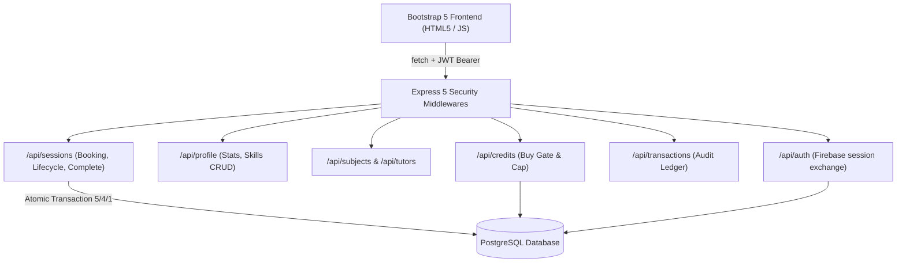

# ⚡ SkillSwap: University Peer-to-Peer Tutoring & Time Banking

**SkillSwap** is a university peer-to-peer academic tutoring platform powered by a localized time-banking economy called **SkillCredits**. Students earn credits by tutoring classmates in their strongest subjects, and spend them when they need academic assistance in other courses.

---

## 🌟 The Core SkillCredit Economy

| Actor | Action / Role | Credit Movement |
|---|---|:---:|
| **New User** | Registration Signup Bonus | **+5 Credits** (from System Wallet `id=0`) |
| **Student** | Completes 1-hour Tutoring Session | **-5 Credits** (`session_charge`) |
| **Tutor** | Conducts Tutoring Session | **+4 Credits** (`session_earning`) |
| **Platform** | System Sink (Inflation prevention) | **+1 Credit** (`platform_fee` to `id=0`) |
| **Credit Purchase** | Allowed only when `balance < 5` | Capped at `10 - balance` |

> [!NOTE]
> All session completion credit transfers are executed inside an **atomic PostgreSQL transaction** (`BEGIN ... COMMIT`) with row-level locks (`SELECT ... FOR UPDATE`), ensuring data consistency and idempotency.

---

## 🏗️ Architecture & Tech Stack

- **Backend:** Node.js, Express 5.x
- **Database:** PostgreSQL with `pg` connection pool
- **Authentication:** Firebase Authentication (email/password and verification links); Firebase Admin verifies ID tokens, while the API issues its own 7-day JWT for SkillSwap endpoints
- **Security:** `express-validator`, `helmet` HTTP security headers, CORS
- **Frontend:** Bootstrap 5.3, responsive CSS3, vanilla JavaScript `fetch` API
- **Testing:** Jest, Supertest



---

## 🚀 Getting Started

### 1. Prerequisites
- Node.js 18+ installed
- PostgreSQL 14+ installed and running

### 2. Configure Firebase Authentication

1. Create a Firebase project and register a **Web app**.
2. In **Authentication → Sign-in method**, enable **Email/Password**.
3. In **Authentication → Settings → Authorized domains**, add the hostname serving this app (for example, `skillswap-mefe.onrender.com`) and `localhost` for local development.
4. Copy the Web app's `apiKey`, `authDomain`, `projectId`, and `appId` into `public/js/firebase-config.js`. This client configuration is public; do not put a service-account key there.
5. In **Project settings → Service accounts**, create a private key. Keep the downloaded JSON secret. Set its full JSON contents as `FIREBASE_SERVICE_ACCOUNT_JSON` on Render; locally, either use that variable or point `FIREBASE_SERVICE_ACCOUNT_PATH` to the private key file outside the repository.

Firebase sends the verification link. A SkillSwap account and its 5-credit signup bonus are created only after the backend verifies Firebase's signed token and confirms `email_verified`.

### 3. Environment Setup (`.env`)
Create a `.env` file in the root directory:
```env
PORT=3000
DB_HOST=localhost
DB_PORT=5433
DB_NAME=skillswap_db
DB_USER=postgres
DB_PASSWORD=your_postgres_password
JWT_SECRET=your_super_secret_jwt_key
FIREBASE_SERVICE_ACCOUNT_PATH=D:\private\skillswap-firebase-admin.json
```

On Render, add `FIREBASE_SERVICE_ACCOUNT_JSON` and `JWT_SECRET` as environment variables. Never commit the service-account JSON or `.env` file.

### 4. Update an Existing Database
Apply the Firebase Auth migration to the existing database; it adds the Firebase UID column and removes the OTP-pending table:
```bash
psql -h localhost -p 5433 -U postgres -d skillswap_db -f models/migrations/001_firebase_auth.sql
```

For a new database, use `models/schema.sql` instead.

### 5. Initialize Database (New Database Only)
Execute the database schema migration script using `psql`:
```bash
psql -h localhost -p 5433 -U postgres -d skillswap_db -f models/schema.sql
```

### 6. Install Dependencies
```bash
npm install
```

### 7. Start the Server
```bash
npm start
```
The application will be live at `http://localhost:3000`.

---

## 🧪 Running Automated Tests

Run the automated test suites powered by **Jest** and **Supertest**:
```bash
npm test
```
The tests cover verified Firebase account provisioning, one-time signup credits,
protected profile access, tutor search and session lifecycle, the atomic 5/4/1
credit transfer, feedback, and credit-purchase rules.

---

## 📡 API Reference Summary

### Authentication & Profile
- Firebase Email/Password sign-up sends the verification link.
- `POST /api/auth/firebase-session` — Verify a Firebase ID token, provision the SkillSwap account after email verification, and return the app JWT.
- `GET /api/profile` — View current user stats & credit balance.
- `PUT /api/profile` — Update user name or role.
- `GET /api/profile/skills` — View user's skills.
- `POST /api/profile/skills` — Add or update subject skill (`can_teach: true/false`, `skill_level`).
- `DELETE /api/profile/skills/:subject_id` — Remove subject skill.

### Tutor Matching & Sessions
- `GET /api/subjects` — List available university subjects.
- `GET /api/tutors?subject_id=&query=` — Search tutors teaching subjects.
- `POST /api/sessions` — Book a session (requires balance $\ge 5$).
- `GET /api/sessions` — List user's sessions as tutor or student.
- `PATCH /api/sessions/:id/accept` — Tutor accepts booking.
- `PATCH /api/sessions/:id/decline` — Tutor declines booking.
- `PATCH /api/sessions/:id/cancel` — Cancel session.
- `POST /api/sessions/:id/complete` — Complete session & trigger atomic 5/4/1 credit split.
- `POST /api/sessions/:id/rate` — Submit rating (1–5) and feedback for tutor.

### Ledger & Credit Purchases
- `GET /api/transactions` — View complete transaction history ledger.
- `GET /api/credits/eligibility` — Check credit purchase eligibility and max buyable cap.
- `POST /api/credits/buy-mock` — Purchase credits via gateway.

---

## 💻 Frontend Pages Walkthrough

- **`index.html`**: Landing page explaining the 5/4/1 economy, live feature stats, and tabbed Sign In / Register forms.
- **`dashboard.html`**: Personal dashboard with credit balance, rating, active sessions table, actionable session buttons (Accept, Decline, Complete Session, Rate Tutor), top-up credit modal, and transactions audit ledger.
- **`search.html`**: Live tutor search filterable by subject dropdown and keyword, displaying tutor rating cards and booking modal.
- **`profile.html`**: Personal profile editor and skill manager (add subjects, toggle `can_teach`, choose skill level, and delete skills).

---

## 📜 License
MIT License &copy; 2026 SkillSwap
